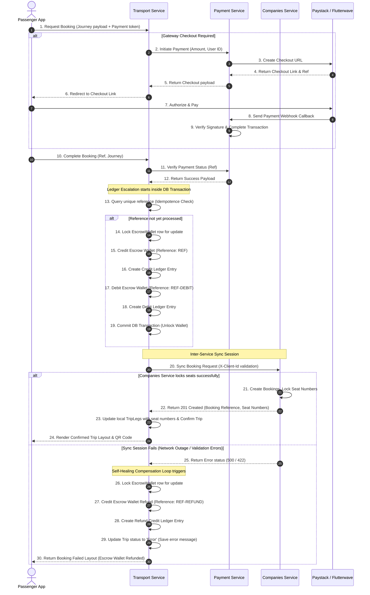
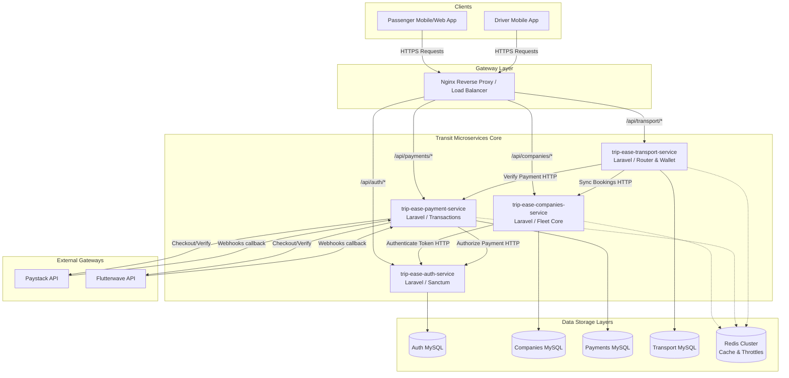

# Transit Booking Microservices - Project Profile

This high-performance transit routing, seat booking, and multi-service logistics ecosystem was architected from the ground up as a distributed microservices network. It implements separate service modules managing user identities, transport operating companies, escrow ledger wallets, and payment gateways.

* **Core Technology Stack:** Laravel (PHP), MySQL, Redis, Flutterwave Gateway, Paystack Gateway, Docker, Docker Compose.

---

## 1. Microservices Architecture

The transit booking system is split across four dedicated Laravel microservices, communicating via secure service API layers:

### A. Authentication Service (`trip-ease-auth-service`)
* **Identity Management:** Coordinates registration, login, profile retrieval (`me`), and Sanctum bearer token management (including list tokens and revocation options).
* **Role-Based Access Control:** Role resource manager controllers (`RoleController`) governing administrative permissions across services.

### B. Fleet & Operator Service (`trip-ease-companies-service`)
* **Corporate Registries:** Manages operator accounts (`CompanyController`), stations/locations (`TerminalController`), active vehicles fleet (`VehicleController`), and staff rosters (`DriverController`).
* **Schedules & Recurring Routes:** Configures schedule series (`ScheduleController`) mapping bidirectional route schedules, route stops, distance indexes, and dynamic pricing metrics.
* **Driver Mobile Auth:** Exposes specialized driver-only authorization endpoints (`DriverLoginController`) supporting native driver applications.
* **Access Control Middleware:** Uses `AuthServiceMiddleware` to validate inter-service signatures on inbound operations requests.

### C. Ledger & Payment Gateway Service (`trip-ease-payment-service`)
* **Payment Router:** Initiates transaction sessions via provider gateways (supporting Paystack and Flutterwave) and monitors status verify endpoints.
* **Webhook Receiver:** Exposes public callback endpoints (`/webhooks/flutterwave`) validating platform signatures to mark transactions as paid.
* **Throughput Gateways:** Protected by `check.service` middleware checking service-to-service validation keys, alongside rate-limiting API throttlers.

### D. Transport & Journey Planner Service (`trip-ease-transport-service`)
* **Trip Routing Queries:** Executes search journey controllers (`searchJourney`) to dynamically locate multi-leg trips, calculate speed/distance metrics, and plan legs.
* **Booking Ledger coordination:** Connects booking states with the payment microservice to verify transactions, credit user escrow wallets, and complete bookings idempotently.
* **Operations Logs updates:** Updates transit schedules and leg progress records (`updateLegStatusBySchedule`).

---

## 2. Escrow Ledger & Idempotency Governance

The ledger system in `trip-ease-transport-service/app/Services/WalletService.php` is engineered to handle ledger credits/debits with strict transaction guarantees:

* **Row Locking (`lockForUpdate`):** Inside database transactions, the service locks the user's specific `EscrowWallet` row. This prevents double-spending anomalies and race conditions during concurrent booking requests.
* **Deadlock Auto-Retry:** Uses Laravel's transaction retry parameters to repeat the transaction block up to **5 times** if a database deadlock is encountered, ensuring seamless completion.
* **Idempotency by Reference:** Prior to modifying any balances, the script checks the `WalletTransaction` database table for the unique reference string (e.g., `$paymentReference` or `$paymentReference . '-DEBIT'`). If found, it immediately returns the existing record without altering the balance again, protecting against double-billing.
* **Audit Logs:** Logs balances before and after operations (`balance_before`, `balance_after`), capturing transaction timestamps and metadata.

---

## 3. System Design & Architectural Review

The platform runs as a distributed event-coordinated microservices cluster. Below is the system architecture sequence outlining the transaction validation, ledger operations, and the self-healing compensation loops.

### A. Journey Booking & Escrow Transaction Sequence

### B. Component System Architecture Diagram

### C. Microservice Component Responsibilities

1. **Authentication Boundary:** Centralizes user profiles and tokens inside Sanctum databases, shielding other endpoints from unauthorized calls.
2. **Double-Spend Protection (Transport Service):** The `lockForUpdate` lock ensures that no concurrent transaction thread can manipulate the same wallet model before the current debit completes.
3. **Idempotence Integrity:** The payments, credits, and debits track distinct references (`REF`, `REF-DEBIT`, `REF-REFUND`). If any request crashes halfway, the client retries safely without risking duplicate funding or duplicate debits.
4. **Autonomous Decoupling:** The `Transport Service` maintains a caching schema of routes. If the `Companies Service` experiences a temporary outage, passengers can still browse journeys. The booking sync acts as the final validation checkpoint during checkout.
5. **Self-Healing Reconciliations:** The fallback compensation loop guarantees that network outages between the Transport and Companies services do not lock passenger capital. If the booking cannot be confirmed, the ledger automatically balances back to zero.
